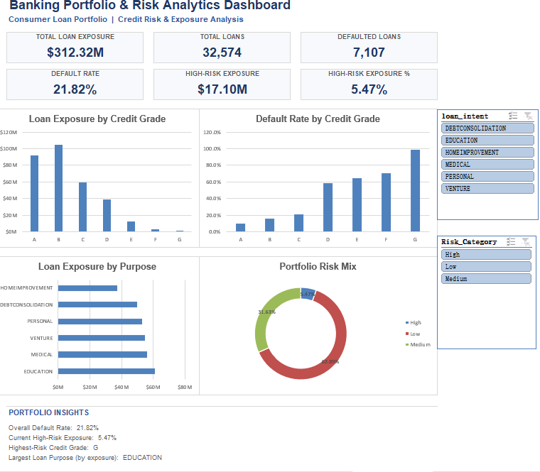

# Banking Portfolio & Credit Risk Analytics Dashboard

An interactive Excel dashboard for analyzing a consumer loan portfolio, monitoring credit risk, and exploring portfolio exposure across credit grades, loan purposes, and risk categories.

The project demonstrates an end-to-end Excel analytics workflow combining data cleaning, data-quality validation, PivotTable analysis, dynamic KPI calculations, interactive slicers, and dashboard visualization.

---

## Dashboard Preview



---

## Project Overview

The objective of this project is to build an interactive banking portfolio and credit-risk analytics dashboard in Microsoft Excel.

The dashboard enables users to monitor portfolio-level KPIs and dynamically explore how loan exposure and default risk change across different borrower and portfolio segments.

The underlying workbook separates data preparation, analytical calculations, supporting PivotTables, and dashboard presentation into distinct layers to create a maintainable analytics workflow.

---

## Business Questions

The dashboard was designed to answer several portfolio and credit-risk questions:

- What is the total loan exposure of the portfolio?
- How many loans are currently represented in the portfolio?
- How many loans have defaulted?
- What is the overall portfolio default rate?
- How much portfolio exposure is classified as high risk?
- What percentage of current exposure is high risk?
- How is loan exposure distributed across credit grades?
- Which credit grades exhibit higher default rates?
- Which loan purposes account for the largest portfolio exposure?
- How does the portfolio risk mix change across different loan segments?

---

## Key Portfolio KPIs

The dashboard tracks six core metrics:

| KPI | Description |
| --- | --- |
| Total Loan Exposure | Total principal exposure across loans in the current portfolio selection |
| Total Loans | Number of loans in the current selection |
| Defaulted Loans | Number of loans classified as defaulted |
| Default Rate | Defaulted Loans ÷ Total Loans |
| High-Risk Exposure | Loan exposure classified as High Risk |
| High-Risk Exposure % | High-Risk Exposure ÷ Total Loan Exposure |

For the unfiltered portfolio, the dataset contains:

- **$312.32M** total loan exposure
- **32,574** loans
- **7,107** defaulted loans
- **21.82%** overall default rate
- **$17.10M** high-risk exposure
- **5.47%** high-risk exposure ratio

---

## Dashboard Features

The interactive dashboard includes:

- Six dynamic portfolio and credit-risk KPI cards
- Loan exposure analysis by credit grade
- Default-rate analysis by credit grade
- Loan exposure analysis by loan purpose
- Portfolio risk-mix visualization
- Interactive `loan_intent` slicer
- Interactive `Risk_Category` slicer
- Dynamic KPI calculations that respond to slicer selections
- Portfolio insight summaries
- Dedicated supporting PivotTables for analytical calculations

Users can combine slicer selections to analyze specific portfolio segments, such as a particular loan purpose within a selected risk category.

---

## Excel Analytics Workflow

The workbook follows a layered analytics architecture:

```text
Source Data
    ↓
Data Cleaning & Quality Validation
    ↓
Clean_Data
    ↓
PivotTables & Analytical Calculations
    ↓
KPI_Support
    ↓
PivotCharts + Dynamic KPI Formulas
    ↑
Slicers / Report Connections
    ↓
Interactive Dashboard
```

This structure separates the source data, analytical layer, filtering logic, and presentation layer.

### Data Cleaning & Quality Control

The source data is prepared before being used for dashboard analysis.

The workbook includes dedicated sheets for:

- cleaned and structured loan data
- data-quality checks
- analytical calculations
- PivotTable-based aggregation
- dashboard-support calculations

A dedicated `Data_Quality_Log` provides visibility into the data preparation and validation process, documenting each cleaning decision with the evidence and rationale behind it — for example, removing records with implausible outliers (age > 100, employment length = 123 years) while deliberately retaining missing values and potential duplicate records where no defensible rule existed to alter them.

The cleaned dataset is maintained separately from the dashboard presentation layer.

### Dynamic KPI Architecture

A key challenge in the project was making dashboard KPIs respond to PivotTable slicers.

Standard formulas referencing the underlying Excel table directly do not automatically respond to PivotTable slicer selections.

To solve this, the workbook uses dedicated slicer-connected support PivotTables.

The resulting calculation flow is:

```text
Slicer Selection
      ↓
Connected PivotTables
      ↓
KPI_Support
      ↓
Dynamic KPI Formulas
      ↓
Dashboard
```

For High-Risk Exposure, the dashboard uses a category-based PivotTable lookup rather than relying on a fixed cell position, allowing the calculation to identify the High risk category correctly as filters change.

### Interactive Filtering

Two slicers provide interactive portfolio segmentation:

**Loan Intent** — Users can analyze portfolio performance across different loan purposes, including categories such as:

- Debt consolidation
- Education
- Home improvement
- Medical
- Personal
- Venture

**Risk Category** — Users can filter the portfolio by:

- Low
- Medium
- High

The slicers are connected to the analytical PivotTables and KPI-support layer through PivotTable report connections. This allows the charts and KPI cards to update consistently as portfolio filters change.

### Credit Risk Analysis

The dashboard provides multiple views of portfolio risk.

**Exposure by Credit Grade** — Shows how total loan exposure is distributed across borrower credit grades.

**Default Rate by Credit Grade** — Compares default performance across credit grades and helps identify segments with elevated credit risk.

**Exposure by Loan Purpose** — Shows which loan purposes contribute the most to total portfolio exposure.

**Portfolio Risk Mix** — Shows the composition of portfolio exposure across Low, Medium, and High risk categories.

Together, these views provide both portfolio concentration and credit-risk perspectives.

---

## Excel Skills Demonstrated

This project demonstrates practical use of:

- Microsoft Excel
- Excel Tables
- Structured References
- PivotTables
- PivotCharts
- Slicers
- Report Connections
- GETPIVOTDATA
- SUM / SUMIF / COUNTIF
- Dynamic KPI calculations
- Percentage and financial number formatting
- Data cleaning
- Data-quality validation
- Dashboard design
- Credit-risk analysis
- Financial portfolio analysis

---

## Workbook Structure

| Worksheet | Purpose |
| --- | --- |
| README | In-workbook project documentation |
| Clean_Data | Cleaned and structured loan dataset |
| Data_Quality_Log | Data-quality checks and validation |
| Analysis | Core analytical calculations |
| PT_Grade_Exposure | Loan exposure analysis by credit grade |
| PT_Grade_Default | Default-rate analysis by credit grade |
| PT_Loan_Purpose | Loan exposure analysis by loan purpose |
| PT_Risk_Mix | Portfolio risk-category analysis |
| KPI_Support | Slicer-responsive support calculations for dashboard KPIs |
| Dashboard | Final interactive banking risk dashboard |

The PivotTable and KPI-support worksheets are hidden in this final presentation version while remaining part of the workbook's analytical architecture. Unhide them from Excel's **Home → Format → Hide & Unhide** menu to inspect the underlying calculations.

---

## How to Use

1. Download `Banking_Portfolio_Risk_Analytics.xlsx`.
2. Open the workbook using Microsoft Excel.
3. Navigate to the Dashboard worksheet.
4. Use the `loan_intent` slicer to filter the portfolio by loan purpose.
5. Use the `Risk_Category` slicer to filter by portfolio risk level.
6. Combine slicer selections for more targeted analysis.
7. Clear the slicer filters to return to the full portfolio view.

For the intended interactive experience, Microsoft Excel is recommended.

---

## Limitations

This project is designed as a portfolio analytics demonstration rather than a production credit-risk model.

The dashboard:

- analyzes historical/static loan data rather than a live banking system
- uses rule-based risk categories rather than a predictive probability-of-default model
- does not represent a production underwriting or regulatory risk framework
- should not be interpreted as financial or lending advice

Future extensions could include automated data refresh, vintage analysis, delinquency tracking, expected-loss modelling, or integration with Power BI.

---

## Repository Structure

```text
banking-portfolio-risk-analytics-excel/
│
├── README.md
├── Banking_Portfolio_Risk_Analytics.xlsx
├── .gitignore
│
└── screenshots/
    ├── dashboard.png
    ├── clean_data.png
    └── data_quality.png
```

---

## Project Purpose

This project was developed as a portfolio project to demonstrate practical Excel-based financial data analysis, interactive dashboard development, and credit-risk analytics.

It focuses not only on visualization, but also on building a structured analytical workflow connecting cleaned source data, PivotTable aggregation, interactive filtering, dynamic KPIs, and business-oriented risk analysis.
